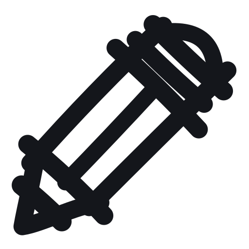

<p align="center">
  <picture>
    <source media="(prefers-color-scheme: dark)" srcset="https://raw.githubusercontent.com/matita-dev/icons/main/.github/brand/logo-light.svg">
    
  </picture>
</p>

<h1 align="center">matita/icons</h1>

<p align="center"><code>@matita/icons</code></p>

Pencil-style icons for the web, drawn by code. Lines overshoot their ends like ruled pencil strokes, boxes cross at the corners, circles overlap where the pen closes, or stop just short. Every glyph is deterministic: the same name always draws the same way.

Browse, search and copy them at [matita.dev](https://matita.dev).

- 440 glyphs · 24 grid · 1.6 stroke · `currentColor`
- Plain, descriptive kebab-case names (`arrow-right`, `trash-2`, `circle-check`)
- Stroke-based, so color and stroke width stay yours to change
- Pencil variant: every stroke drawn as two or three loose pencil lines, with paper grain
- Wobble: turn the hand down to 0 and every icon is drawn as exact shapes, true lines, circles and corners

## Install

```sh
npm i @matita/icons
```

## Use

```jsx
import { ArrowRight, SketchIcon, SketchIconProvider } from '@matita/icons/react';

<ArrowRight size={20} color="#2748F5" />
<SketchIcon name="crosshair" pencil />
<SketchIconProvider size={24} strokeWidth={1.4}>…</SketchIconProvider>
```

```js
import { Ruler, toSvg } from '@matita/icons';
toSvg(Ruler, { size: 24 });               // SVG string
```

```html
<i data-sketch-icon="ruler" data-size="24"></i>
<script src="https://cdn.jsdelivr.net/npm/@matita/icons/dist/umd/sketch-icons.min.js"></script>
<script>SketchIcons.replaceIcons({ icons: SketchIcons.icons });</script>
```

Plain files: `@matita/icons/icons/<name>.svg`, `@matita/icons/pencil/<name>.svg`, `@matita/icons/exact/<name>.svg`, `@matita/icons/sprite.svg`, `@matita/icons/icons.json`. For the pencil grain, import `@matita/icons/pencil.css` (the `pencil/<name>.svg` files have it built in).

`@matita/icons/pencil.css` also sets the icons' default layout (`display:inline-block; flex:none`) at zero specificity, so your own classes (`hidden`, `block`, `shrink`) still win. Without that import, icons use browser defaults: add `shrink-0` (and `min-w-0` on the text beside them) in flex rows.

## Use Matita in shadcn/ui

`@matita/icons/shadcn` exports 337 components named exactly like the icon names the shadcn CLI writes into the components it installs (`ChevronDownIcon`, `CheckIcon`, `Loader2Icon`), and every one of those is also exported as the bare name (`ChevronDown`, `Check`, `Loader2`), which is what the older styles import. Each one draws a Matita glyph or one of its alternate names, forwards its `ref`, and passes `className`, `data-icon`, `data-slot` and `aria-*` to the `<svg>`. Every name the base, radix and aria component sets use resolves to a drawing: nothing is stubbed.

```sh
npm i @matita/icons
```

```jsx
import { ChevronDownIcon, SearchIcon } from '@matita/icons/shadcn';
```

**Installed components.** The `iconLibrary` field of `components.json` is a closed list of built-in libraries today, and the CLI leaves a value it does not know unchanged in the installed file, so a custom value does not work yet (there is an open upstream proposal to accept an import path). Until then, install with any built-in value and point the imports at Matita with one replacement, for example in each file under `components/ui`:

```powershell
# swap the module the CLI imported for Matita
Get-ChildItem components,hooks -Recurse -Include *.tsx,*.ts | ForEach-Object { (Get-Content $_) -replace 'from "<package the CLI imported>"','from "@matita/icons/shadcn"' | Set-Content $_ }
```

```sh
grep -rl 'from "<package the CLI imported>"' components hooks | xargs sed -i 's#from "<package the CLI imported>"#from "@matita/icons/shadcn"#'
```

Check the result with your type checker: a name that is not exported is an error, never a silent fallback. This works for the base, radix and aria component sets (the `nova`, `vega`, `maia`, `lyra`, `mira`, `luma`, `sera` and `rhea` presets). The `new-york-v4` and legacy styles import their icon package directly in every file, so no `iconLibrary` value reaches them; for those, alias that package name to `@matita/icons/shadcn` in your bundler (`resolve.alias` in Vite, `turbopack.resolveAlias` and `webpack` aliases in Next.js, `paths` for TypeScript), which is a stop-gap rather than a supported route. It was checked against every component of those styles and the sidebar, login, signup, otp and calendar blocks: all icon names resolve, in a Vite build and in a webpack 5 build, with only the icons you use ending up in the bundle (in webpack alias the exact name, `"<package>$"`, so sub-paths are left alone). Two caveats: a TypeScript `import type { <icon type> }` from that package has no counterpart here (bundlers erase it, but the type checker will flag it; use `SketchIconComponent` from `@matita/icons/react` instead), and the legacy `default` style's `input-otp` imports a `Dot` icon that Matita has no glyph for yet.

**Defaults.** The shadcn components size their icons with CSS (`size-4` and friends), which wins over the `width` and `height` attributes, so the fallback size only matters for an icon you use bare: it is 24 here (16 for the other entries). The stroke is the usual 1.6; for a heavier line pass `strokeWidth={2}` or wrap the app once in `<SketchIconProvider strokeWidth={2}>` (from `@matita/icons/react`; a `size` there overrides the 24 as well). No provider is required.

**CSS.** The entry does not import any CSS, so it works in a bundler without CSS support and in Node. Every module in the React and shadcn entries starts with the `"use client"` directive, so in a Next.js App Router server component you can import an icon directly; it renders as a client component, and the props you pass must be serializable. That means icons use browser defaults for `display` and `flex`, which is what the shadcn components expect (they set `shrink-0` and sizing themselves, and toggle icons with `hidden` and `inline`, which work because the renderer sets no inline `display`). Import `@matita/icons/pencil.css` once if you want Matita's inline-block and no-shrink defaults for icons in your own markup, or the paper grain of the pencil variant.

## Use with AI coding assistants

Paste this into `CLAUDE.md`, `AGENTS.md`, a Cursor rule or `.github/copilot-instructions.md`. It tells the assistant how to find icon names that exist and how to import them. It does not make an assistant choose Matita; it helps one that already uses it.

```markdown
## Icons: @matita/icons

This project uses `@matita/icons` (ESM only, 24 grid, `currentColor`).

- Install with `npm i @matita/icons`. Import named React components: `import { ArrowRight, SearchIcon } from '@matita/icons/react';`
- Every icon is exported as `PascalCase` and `PascalCaseIcon` (`arrow-right` is `ArrowRight` and `ArrowRightIcon`, `trash-2` is `Trash2`).
- Never invent a name. Search `node_modules/@matita/icons/dist/keywords.json` for the concept: it has every glyph name with a keyword list, and the `aliases` field maps alternate names (`house`, `x-circle`) to a glyph. If nothing fits, say so and ask. Do not guess.
- Do not read `dist/icons.json` whole: it is about 244 KB of path data. `keywords.json` (about 26 KB) has every name. `node_modules/@matita/icons/dist/llms.txt` is a short guide (also https://matita.dev/llms.txt), and `dist/llms-full.txt` adds keywords per glyph.
- Use `<SketchIcon name="..." />` only when the name comes from data at run time. It loads the whole set; named imports do not.
- Props: `size` (px, default 16), `color` (default `currentColor`), `strokeWidth` (default 1.6), `title` (accessible label). Icons without `title` are hidden from screen readers, so label icon-only buttons with `aria-label` on the button.
- Set shared defaults once with `<SketchIconProvider size={20}>`. Do not set sizes icon by icon.
- Optional: `import '@matita/icons/pencil.css'` once, for paper grain on the `pencil` variant and for `inline-block` / no-shrink defaults.
- ESM only, no CommonJS build. `require()` of the package works on Node 20.19+ and 22.12+ (older Node needs `import`). Jest's default setup does not transform `node_modules`, so a CommonJS Jest project fails with `Unexpected token 'export'`: run Jest in ESM mode, or transform the package with a project-wide Babel config (`babel.config.json` with a preset such as `@babel/preset-env`; a `.babelrc` does not reach `node_modules`) plus `transformIgnorePatterns: ['/node_modules/(?!@matita/)']`. Plain SVG files are in `@matita/icons/icons/<name>.svg`, with a sprite at `@matita/icons/sprite.svg`.
- Do not copy SVG paths into the code. Do not add fills: the icons are strokes.
- The React and shadcn entries carry the `"use client"` directive, so an icon can be imported in a Next.js App Router server component and renders as a client component. Pass serializable props (numbers, strings), not functions.
```

Per-tool notes are in [docs/ai-instructions.md](https://github.com/matita-dev/icons/blob/main/docs/ai-instructions.md). The package ships `dist/llms.txt` (a short guide: when to use, imports, props, look-alike warnings, every glyph name) and `dist/llms-full.txt` (the same plus keywords per glyph and the alternate-name table, about 30 KB); import them as `@matita/icons/llms.txt` and `@matita/icons/llms-full.txt`. [matita.dev/llms.txt](https://matita.dev/llms.txt) serves the short guide on the web, and [matita.dev/icons.json](https://matita.dev/icons.json) lists every icon with the version that added it, so a tool can check a name exists instead of guessing. The names are also a typed union (`SketchIconName`) for TypeScript.

## Alternate names

Some icons are known by more than one name, so Matita also exports a few spellings that point at an existing glyph: `House` and `Home`, `Ellipsis` and `MoreHorizontal`, `CheckCircle` and `CircleCheck`. An alternate name draws the glyph it points at, in both name styles (`House` and `HouseIcon`), from `@matita/icons` and `@matita/icons/react`, and `<SketchIcon name="house" />` accepts it too. They are plain re-exports, so importing one pulls in only that glyph.

```jsx
import { House } from '@matita/icons/react';   // the same drawing as Home
```

The full list is `ALIASES` (alternate name to glyph), also the `aliases` field of `icons.json` and `keywords.json`, and the `SketchIconName` type accepts both kinds of name. `APPROXIMATE_ALIASES` (`approximateAliases` in the JSON) lists the ones where the glyph is the closest match rather than the same drawing, for example `CheckCircle`, `BarChart` and `Settings2`. `names` and `icons` still hold the glyphs only. For the plain script tag, pass the list along: `SketchIcons.replaceIcons({ icons: SketchIcons.icons, aliases: SketchIcons.ALIASES })`.

Two glyphs are drawn differently from what the same name suggests elsewhere, so check them before relying on a name: `chart-bar` is vertical bars on an axis (there is no alias for horizontal bars), and `loader` is a single open arc, which is what `loader-circle` and `loader-2` show too.

## Right-to-left layouts

Arrows, chevrons, undo and redo, sign in and out, sidebars and similar glyphs point the way you read. In a right-to-left layout (Arabic, Hebrew, Persian) pass `mirror` and the icon is drawn flipped horizontally:

```jsx
<ArrowRight mirror={isRtl} />
<SketchIcon name="chevron-right" mirror={isRtl} />
```

`MIRROR` (also the `mirror` field of `icons.json` and `keywords.json`) lists the glyphs that want it; symmetric glyphs, media controls and refresh arrows are not on it. `mirror` works on any icon, so the list is advice, and without the prop nothing changes.

## Wobble: from sketch to exact shapes

`wobble` goes from 1 (the default: the full hand) down to 0 (the same glyph as exact shapes: true lines, circles, arcs and square corners, no overshoot). In between you get a calmer hand.

```jsx
<SketchIcon name="calendar" wobble={0} />      // exact shapes
<SketchIcon name="calendar" wobble={0.4} />    // a calm hand
```

```js
import { drawIcon } from '@matita/icons/engine';
import { toSvg } from '@matita/icons';
toSvg(drawIcon('calendar', { wobble: 0 }), { size: 24 });
```

Exact shapes don't depend on the seed, and wobble 1 draws exactly what 0.3.0 drew. Ready-made exact files are in `@matita/icons/exact/<name>.svg`.

## Grain: from solid lines to paper texture

With `pencil.css` loaded, the `--matita-grain` CSS variable sets how much paper grain shows in pencil icons: 1 (the default) is the full grain, 0 is a solid line. Set it anywhere, on an icon or a parent.

```css
.toolbar { --matita-grain: 0.5; }
```

Without `pencil.css` there's no grain, so the variable does nothing. The `pencil/<name>.svg` files keep their built-in grain.

## Rough: from pencil to crayon

`rough` goes from 0 (the default: today's pencil) to 1 (crayon-rough). It only changes the pencil texture: the lines get wider, looser and a little lighter, and with `pencil.css` the paper gets coarser, with more of it showing through. `wobble` is the one that bends the shape, so the two combine freely.

```jsx
<SketchIcon name="star" pencil rough={0.5} />
<SketchIconProvider pencil rough={1}>…</SketchIconProvider>
```

```js
toSvg(Star, { pencil: true, rough: 1 });
```

```html
<i data-sketch-icon="star" data-pencil data-rough="0.5"></i>
```

`rough` only applies to pencil icons and works in steps of 0.05. It isn't perfectly smooth: from 0.75 each stroke gets one more pencil line, so the drawing changes a little more at that point. `pencil.css` has two coarser paper textures and picks the nearest one, and `--matita-grain` still dials the grain on top. At 16px the top of the range starts to fill in small closed shapes (the middle of a star, a small loop), so keep `rough` lower there. The `pencil/<name>.svg` files are unchanged.

## Add an icon

Glyphs are drafting primitives on a 24 grid in `src/defs.js`:

`L` line · `P` polyline · `Z` closed · `R` rect · `C` circle · `E` ellipse · `A` arc · `Q` curve · `S` smooth line · `B` Bezier path · `O` dot

Keep to 2–5 primitives, stay inside the 1–23 grid, no fills, short descriptive kebab-case names. Then `npm run build && npm test`.

## Develop

```sh
npm ci
npm run build   # lint + dist
npm test
```

The matita.dev website is built from the published package and lives in its own repository, not here.

## Open source promise

Matita is free and MIT licensed, and it stays that way. Every release already published stays available under its license, and every future release is open source too. Nothing in the package is held back for a paid tier.

## Support Matita

If Matita is useful to you, you can [sponsor its development on GitHub](https://github.com/sponsors/ldons).

## Changes

See [CHANGELOG.md](https://github.com/matita-dev/icons/blob/main/CHANGELOG.md).

## License

MIT © Matita contributors

Made by [herocreativ](https://herocreativ.com), a design and development studio. Need custom icons or a design system? [Get in touch](https://herocreativ.com).
